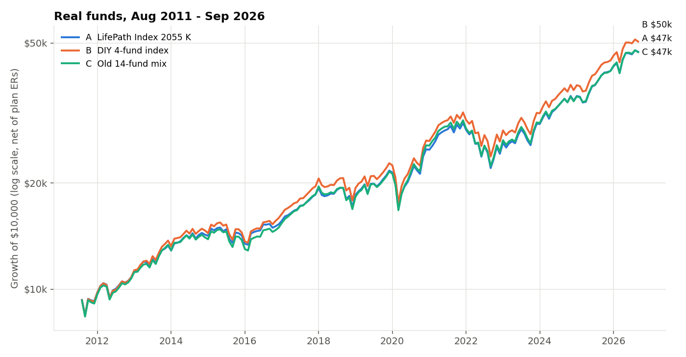
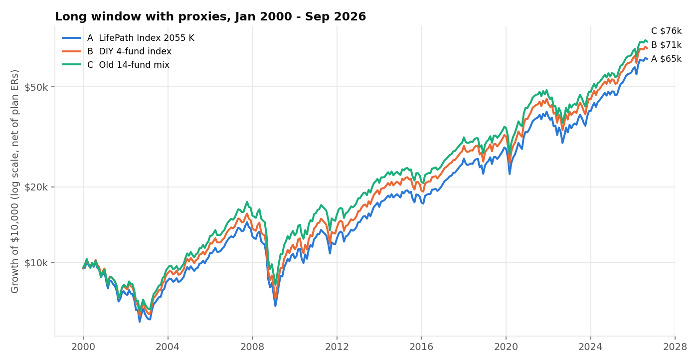
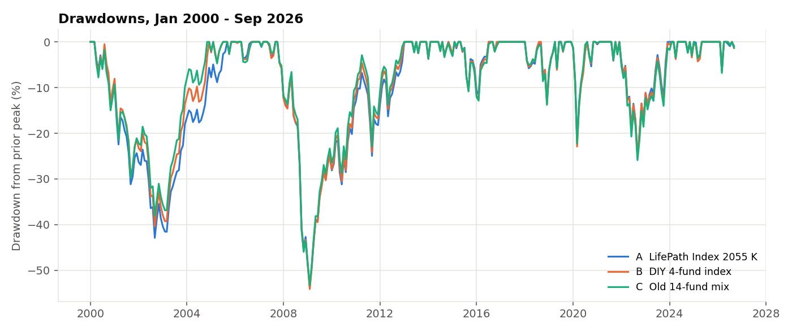
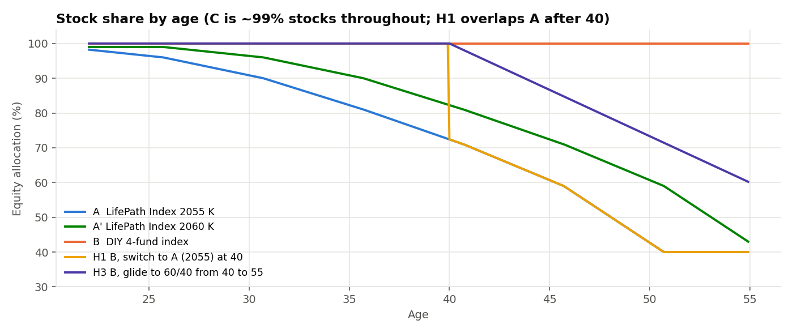
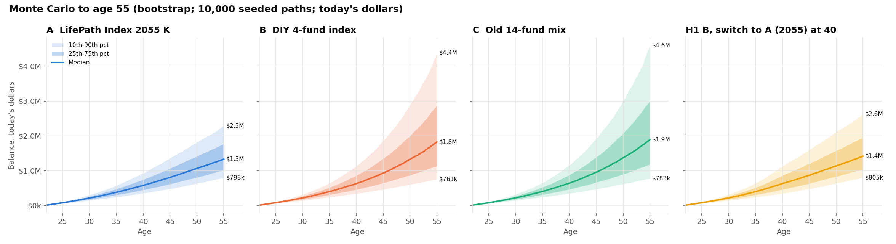
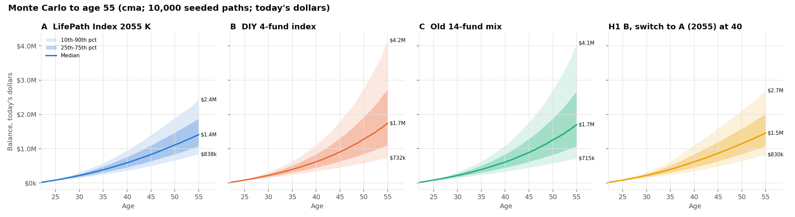
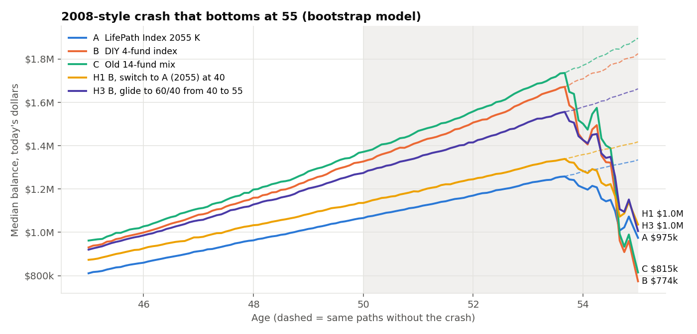
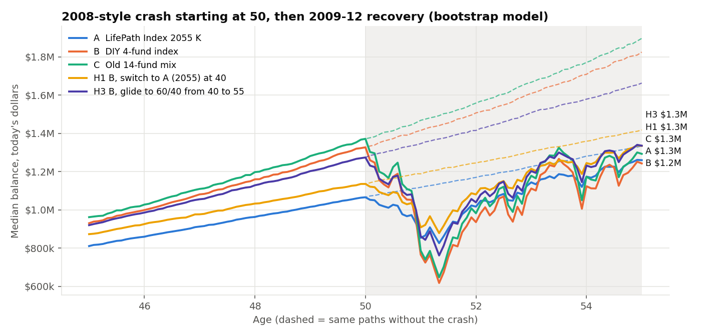

# 401(k) fund choice: LifePath 2055 vs DIY index vs old 14-fund mix

Research as of 2026-09-29. This is decision support, not financial advice, and I'm not a licensed advisor.
The data runs through 2026-09-28. Everything regenerates with `python fetch.py <tickers>` and then
`python analysis.py` (seed 20260929, 10,000 paths, about 11 seconds).

## Summary

| | **A** LifePath Index 2055 K | **B** DIY 4-fund index | **C** Old 14-fund mix | **H1** B now, switch to A at 40 | **H3** B, glide to 60/40 from 40→55 |
|---|---|---|---|---|---|
| Weighted expense ratio | 0.09% | 0.03% | ~0.21% | 0.03% → 0.09% | ~0.03% |
| Stocks today → at 55 | 98% → **40%** (hits 40% at ~51) | 100% → 100% | ~99% → 99% | 100% → 40% | 100% → 60% |
| **Backtest, real funds** (Aug 2011–Sep 2026): CAGR | 10.8% | **11.3%** | 10.8% | — | — |
| Same, ending $ with your contributions | $858k | **$888k** | $860k | — | — |
| **Backtest, long** (Jan 2000–Sep 2026): CAGR / max DD | 7.2% / −54% | 7.6% / −54% | **7.9%** / −53% | — | — |
| Worst 12 months (long window) | −46% | −47% | −46% | — | — |
| **Monte Carlo median at 55** (bootstrap / forward CMA)* | $1.33M / $1.41M | **$1.83M / $1.74M** | $1.90M / $1.70M | $1.42M / $1.46M | $1.66M / $1.63M |
| MC 10th percentile at 55 | $0.80M / $0.84M | $0.76M / $0.73M | $0.78M / $0.72M | $0.81M / $0.83M | $0.81M / $0.80M |
| MC 90th percentile at 55 | $2.29M / $2.43M | $4.38M / $4.16M | $4.60M / $4.08M | $2.62M / $2.69M | $3.54M / $3.44M |
| Chance of a >25% drop from a peak between 50 and 55 | **4%** | 47% | 44% | **4%** | 25% |
| **2008 crash bottoming at 55**: median balance at 55 | $0.97M / $1.02M | $0.77M / $0.74M | $0.81M / $0.74M | **$1.04M / $1.06M** | $1.01M / $0.98M |
| 2008 crash at 50, then 2009–12 recovery: median at 55 | $1.26M / $1.30M | $1.24M / $1.20M | $1.29M / $1.19M | **$1.33M / $1.35M** | **$1.34M / $1.31M** |

\*Monte Carlo figures are in today's dollars (after inflation). They assume $16,825 today plus $19,800 a year
held flat in real terms, age 22 to 55. "Bootstrap" reshuffles real 2000–2026 returns in 12-month blocks.
"CMA" uses the same shocks but moves each asset class's mean to a forward-looking estimate, and it gives
active funds zero skill before fees. Backtests are in nominal dollars and assume a $16,825 start plus
$1,650 a month.

### Answers to your questions

1. **Which option is expected to produce the most money? B.** Of the options that stay all-stock, B has
   the highest expected balance at 55: a median of about $1.74–1.83M versus $1.33–1.41M for A. That's
   **about $330–500k more, or roughly 23–38%**. B finishes ahead of A in 74–82% of simulated paths. Almost
   none of the gap comes from fees (0.03% vs 0.09%). It comes from A's glide path, which moves you to 40%
   stocks by about age 51.
   - **C vs B is close and depends on history.** In the real-fund window (2011–2026), C trailed B by
     0.5%/yr. In the longer 2000–2026 window, C was slightly ahead because New World (emerging markets)
     and its small/mid/value funds had a strong 2000s. The bootstrap re-uses that history, so C's median
     comes out a little higher there. If active funds have no skill going forward (the CMA model), fees
     alone put C about 2% behind B at 55, and B beats C in 77% of paths. C also carries about 7× B's
     costs and 13 funds to maintain. The data doesn't support C holding a *reliable* edge.
2. **Which is safest near 55? A, and H1, which becomes A at 40.** Between 50 and 55, A has a 4% chance
   of falling more than 25% from a peak, versus 47% for B. If a 2008-style crash bottoms exactly at 55,
   A's median ends around $0.97–1.02M and B's around $0.74–0.77M. B would have to fall 56% from its
   peak, against about 24% for A. The 10th-percentile outcome barely differs, though ($0.73–0.84M for
   every option). Most of what the glide path buys is protection against *badly timed* crashes. It gives
   up a lot of upside in return and improves typical bad outcomes only a little.
3. **Does a hybrid beat both? Partly.**
   - **H1 (B now, switch to A at 40)** beats A outright. Its median is 3–7% higher ($1.42–1.46M vs
     $1.33–1.41M), it's ahead of A in 69–80% of paths, and it carries A's exact risk after 40. It's also among the best in both crash tests.
     It does **not** beat B on expected money.
   - **H3 (B, then gradually add bonds from 40 to reach 60/40 at 55)** is the middle option. Its median
     is about $1.63–1.66M, about 91–94% of B's, with half of B's chance of a >25% late drawdown (25%).
   - No option wins on every measure. The trade is expected money versus exposure to a crash timed near
     55. Because the choice can be changed any time in Empower, the decision that sets your risk is
     **what you hold from about 40–45 onward**, not what you pick at 22. From 22 to 40, B and A are both
     nearly all stock (A slides from 98% to 72%), and B costs less.
4. **Something the question doesn't ask: the 2055 vintage is early for a 55 retirement.** BlackRock's
   2055 fund reaches its most conservative mix (40/60) in 2055, when you'd be about 51. The **2060
   vintage** (A′ in the tables) lines up with 55 and gives a median about 6–8% higher than A with somewhat
   more late-stage risk. If you want the target-date route, the 2055 vs 2060 choice matters about as
   much as the fees do.

## 1. Fund facts

- **Ticker:** BlackRock LifePath Index 2055 Fund, Class K = **LIVKX** (fund launched 5/31/2011). Net
  expense ratio **0.09%** (gross 0.13%; the fee waiver runs through 6/30/2027).
- **Current split (fact sheet 6/30/2026):** 96.7% equity, 2.0% fixed income, 1.3% cash. The benchmark is
  98.0/2.0. Holdings: Russell 1000 index 55.9%, iShares MSCI Total International 37.2%, small cap 3.5%,
  REIT 1.2%, US long credit bond 1.9%.
- **Published glide path.** This is the prospectus supplement effective about June 1, 2026. It raised
  equity by up to about 6% starting 30 years out; equity at the target date is unchanged.

  | Years to 2055 | 45–30 | 25 | 20 | 15 | 10 | 5 | 0 (and after) |
  |---|---|---|---|---|---|---|---|
  | Equity (incl. REITs) | 99% | 96% | 90% | 81% | 71% | 59% | 40% |

  After the target date, the fund holds a static 40/60 mix like the LifePath Index Retirement fund. I
  interpolate linearly between the table points and treat the target date as mid-2055.
- Sources: [LIVKX fact sheet 6/30/2026](https://www.blackrock.com/us/individual/literature/fact-sheet/lifepath-index-2055-fund-class-k-usd-factsheet-us0669236327-us-en-individual.pdf),
  [LifePath Index 2055 summary prospectus + 2026 glide-path supplement](https://www.blackrock.com/us/individual/literature/summary-prospectus/sumpro-lpi2055-p-us.pdf),
  [BlackRock fund page](https://www.blackrock.com/us/individual/products/227854/blackrock-lifepath-index-2055-portfoliocl-k-fund).

## 2. Data

Alpha Vantage `TIME_SERIES_MONTHLY_ADJUSTED` (dividend-adjusted) for 26 tickers, plus US CPI. Alpha
Vantage's history for every one of these starts in Dec 1999, so the long window is **Jan 2000 – Sep
2026**. That window covers the dot-com bust and 2008. Finnhub wasn't used: its free tier has no candles.
Raw responses are cached in `data/raw/`. The key is read from `.env.news` and is never printed or saved.

| Plan fund | Series used (preferred → fallback for earlier years) | Plan ER used |
|---|---|---|
| Empower S&P 500 Index SA | VFIAX → VFINX (ER added back to 0.00%) | 0.00% |
| VTSNX | VTSNX → VGTSX | 0.06% |
| VIMAX / VSMAX | VIMAX → VIMSX / VSMAX → NAESX | 0.05% |
| American Funds New World R6 | RNWGX → NEWFX (A shares) | 0.57% |
| Large Cap Growth III | **VIGRX (large-growth index proxy)**. This is a plan-specific fund with no public history | 0.25% (assumed) |
| Putnam Intl Value R6 | PNGAX (A shares) | 0.66% |
| T. Rowe Price Value | TRVLX | 0.57% |
| Franklin Stable Value | **VFISX (short Treasuries) proxy** | 0.30% (assumed) |
| MFS Mid Cap Growth R6 | OTCKX → OTCAX | 0.66% |
| VGSLX | VGSLX → VGSIX | 0.13% |
| Victory Sycamore (**assumed Established Value R6**) | VETAX → VIMSX | 0.54% |
| American Century Small Cap Growth R6 | ANODX → ANOIX → NAESX | 0.82% |
| **A: LifePath 2055 K** | **LIVKX actual** (2011+); before that, rebuilt from VFIAX/VTSNX/VSMAX/VGSLX/VBTLX blocks with the glide path, less 0.09% | 0.09% |

Every monthly return is shifted by (that share class's ER − the plan's ER)/12, so all three options are
compared **net of the plan's own costs**. The implied weighted ER for C comes out to 0.207%, which
matches your ~0.21%.

**Data checks and fixes**
- LIVKX annual returns match the fact sheet exactly for 2021, 2022, 2023 and 2025, and its 1/3/5-year
  trailing returns match exactly. **Alpha Vantage is missing LIVKX's 2024 distributions** (it shows
  13.65% vs the published 16.29%). I rescaled December 2024 to match the published year
  (`CALENDAR_YEAR_FIXES` in `analysis.py`). The 10-year number is still 0.09%/yr short of the published
  12.36%, probably from an under-recorded Dec-2016 distribution. That slightly *understates* A before 2021.
- I scanned all 26 series for distributions that look missing. The other flags were either genuine
  growth/value months or had the distribution recorded.
- The rebuilt A tracks real LIVKX with a 0.997 correlation and 1.0%/yr tracking error, but it ran
  0.5%/yr **ahead** of the real fund from 2011 to 2026 (the real fund held cash, used the older and more
  conservative glide path, and tracks the Russell 1000 rather than the S&P 500). So the long-window and
  Monte Carlo results for A are, if anything, flattered. See `charts/a_reconstruction_check.png`.

## 3. Backtests





In the backtests, A is barely distinguishable from B and C. That's expected: over 2000–2026 a 2055 fund
was 29–55 years from its date, so it was about 99% stocks the whole time. **The backtests can't show the
difference that matters, which is the last 15 years before 55.** The Monte Carlo and crash tests below
are where that shows up. All three lost about 54% peak to trough in 2008. Full tables, including
calendar-year returns, are in `results/`.

## 4. Monte Carlo to age 55





Setup (all in `analysis.py`):
- **Horizon:** Oct 2026 (age 22) to Sep 2059 (age 55), 396 months.
- **Money in:** start at $16,825, then $1,650 a month ($19,800/yr), flat in today's dollars. Raising to
  17% adds about $990/yr and moves every option's outcome by roughly +5%, so the ranking doesn't change.
- **Returns:** real (CPI-deflated) monthly returns for every fund, sampled jointly so correlations are
  preserved. The **same 10,000 random draws** are used for every strategy, so comparisons are paired.
  Weights are rebalanced monthly.
- **Model 1, bootstrap:** 12-month blocks resampled from Jan 2000 – Aug 2026. Historical real CAGRs in
  that window: US large 5.5%, mid 7.3%, small 6.4%, international 2.6%, REIT 6.9%, bonds 1.3%, short
  Treasuries 0.3%.
- **Model 2, forward CMA:** the same shocks with each asset class's mean shifted to these real returns:
  US large 4.2%, mid 4.5%, small 4.8%, international 5.0%, REIT 4.0%, bonds 2.0%, stable value 1.2%.
  These are my rounded assumptions. They're set to be broadly consistent with published 2026 long-term
  capital market assumptions (J.P. Morgan's 2026 LTCMA puts a USD 60/40 at 6.4% nominal), not copied
  from them. Active funds equal their asset class minus their ER, meaning zero skill.
- **Modeling A:** the prospectus glide path is applied month by month to the index blocks, less 0.09%.
  I also ran A′ (the 2060 vintage) and the hybrids H1 (B → A 2055 at 40), H2 (B → A′ 2060 at 40) and
  H3 (B scaled down linearly to 60% stocks + 40% bond index at 0.05%, from 40 to 55).

The full percentile tables for both models are in [`results/summary_tables.md`](results/summary_tables.md).

## 5. Sequence-of-returns risk: a 2008-style crash in the last 5 years

The actual real monthly returns of every fund from Nov 2007 onward are pasted over the end of every
simulated path. That sequence is US large −52%, international −59% and bonds +5% (real) from peak to
trough.
- **Crash bottoms at 55:** Nov 2007 – Feb 2009 is placed in the last 16 months.
- **Crash starts at 50:** Nov 2007 – Oct 2012 (the crash plus the recovery) fills ages 50–55.




If the crash bottoms at 55, B's median path loses about $1.05M from what it would have been (a 58% hit)
and ends around $0.77M. A loses about $0.36M (27%) and ends around $0.97M. If the crash comes at 50 and
you don't need the money until 55, the recovery closes most of the gap: B at $1.24M, A at $1.26M, and
H1 and H3 best at about $1.33–1.34M. **Crash timing relative to when you start withdrawing matters more than which fund
you picked.** If you retire at 50 on a Roth ladder or taxable bridge, the "crash at 50" case is the one
that applies to you.

## 6. Assumptions and limits (read these)

- **The history is short.** 26.7 years with one dominant pattern: strong US large caps, weak
  international. The bootstrap assumes the future looks like that period reshuffled. The CMA model is
  there to check how much the answer depends on it. The ranking of B vs A holds in both models; C vs B
  flips between them.
- **Proxies:** Large Cap Growth III, the stable value fund and the Victory Sycamore fund (8%, 1% and 1% of
  C) are proxies. I'm not certain which Victory Sycamore fund your plan offers. Fallback share classes
  use approximate current ERs. Stable value was modeled as short Treasuries; the real product is smoother
  and usually pays more, but at 1% of C that doesn't matter.
- **LifePath's bond sleeve** is modeled as the US aggregate bond index. The real fund mixes long and
  intermediate credit, government bonds, securitized debt, short TIPS and infrastructure, and BlackRock
  can change the mix or the glide path again (it did in 2026).
- **Left out:** taxes (all inside the 401(k), so pre-tax vs Roth doesn't change this comparison), any
  plan or record-keeping fees beyond ERs, salary raises, changes to IRS limits, withdrawals before 55,
  and behavior. Behavior matters: B only works if you actually hold through a −50% year and rebalance
  once a year. A does both automatically.
- **The Monte Carlo is not a forecast.** The spread between the 10th and 90th percentiles ($0.8M to
  $4.4M for B) is the honest message. The medians are more precise than they are accurate.
- **Your whole portfolio:** this looks at the 401(k) alone. You also hold about $62k in cash and $32k in
  a single stock (LITE) in taxable, plus a Roth IRA. How much total stock/bond risk you're carrying at
  50–55 is a household-level question, and the 401(k) doesn't have to be where the bonds live.
- **Rule of 55:** it applies to the 401(k) of the employer you leave in or after the calendar year you
  turn 55. If you retire at 50, this 401(k) isn't reachable penalty-free without 72(t) or a Roth ladder
  (each conversion needs 5 years to season). That makes the 50–55 bridge money the part most exposed to
  sequence risk.

## Files

- `fetch.py`: Alpha Vantage downloader with a cache. The key comes from `.env.news` or the environment.
- `analysis.py`: backtests, Monte Carlo, crash overlays, charts and tables.
- `data/raw/`: cached price and CPI JSON.
- `results/results.json`: every metric, plus which ticker supplied each series in each period.
- `results/summary_tables.md`: full backtest and Monte Carlo tables.
- `results/monthly_returns_net_of_plan_er.csv` and `results/calendar_year_returns_long_window.csv`
- `charts/`: equity curves, drawdowns, glide paths, Monte Carlo fans, crash scenarios, A reconstruction check.

To reproduce:
```bash
cd research/401k-fund-choice && python3 -m venv .venv && .venv/bin/pip install -r requirements.txt && .venv/bin/python analysis.py
```
